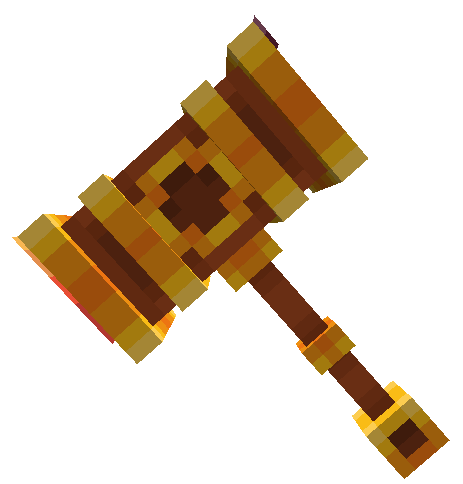

# 🛒 Outils Black Friday

## 🔷 <mark style="color:green;">Son obtention 🤔</mark>

Le <mark style="color:orange;">**Marteau Black Friday**</mark> s'obtient dans le [<mark style="color:orange;">**Pack Black Friday**</mark>](https://wiki.evolucraft.fr/le-gameplay/black-friday#pack-black-friday) ou encore à <mark style="color:green;">l'achat</mark> dans [<mark style="color:green;">l'hôtel de vente</mark>](https://wiki.evolucraft.fr/le-gameplay/le-commerce#hotel-des-ventes).

## 🔷 <mark style="color:green;">Son aperçu 🔍</mark>

<table border="1" cellspacing="0" cellpadding="6">
  <tr>
    <td align="center"><strong><ins>Nom</ins> 🏷️</strong></td>
    <td align="center"><strong><ins>Enchantement</ins> 📖</strong></td>
    <td align="center"><strong><ins>Durabilité</ins> 📏</strong></td>
    <td align="center"><strong><ins>Effet</ins> ✨</strong></td>
  </tr>
  <tr>
   <td align="center">
     
<mark style="color:orange;"><strong>Marteau Black Friday</strong></mark>

     
<figure></figure>

   </td>
   <td>
     
▸ <mark style="color:orange;"><strong>Fortune V</strong></mark>

     
▸ <mark style="color:orange;"><strong>Efficacité VII</strong></mark>

   </td>
   <td align="center">
     
<mark style="color:orange;"><strong>6 000</strong></mark> de <mark style="color:orange;"><strong>Durabilité</strong></mark>

   </td>
   <td>
     
▸ <mark style="color:orange;"><strong>Effet Hammer</strong></mark> : Casse les blocs dans une zone de 3X3.

   </td>
  </tr>
</table>
