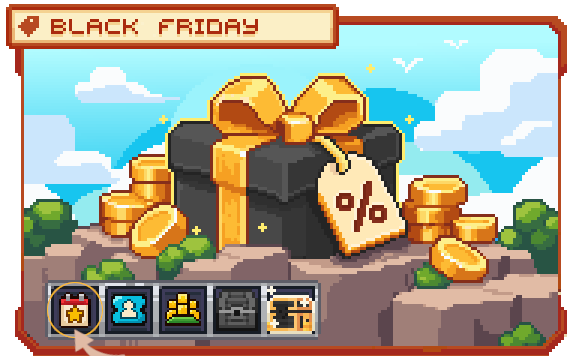
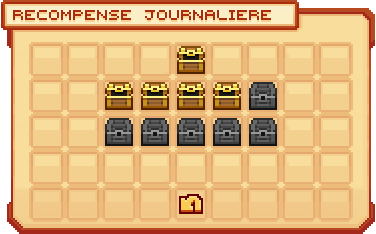
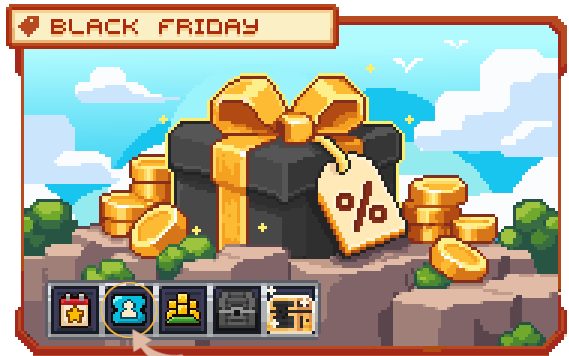
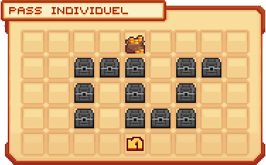
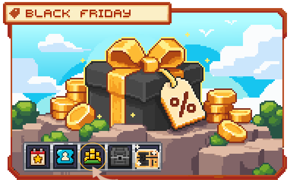
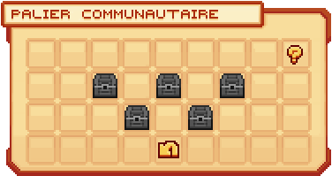
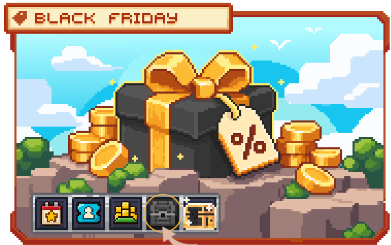
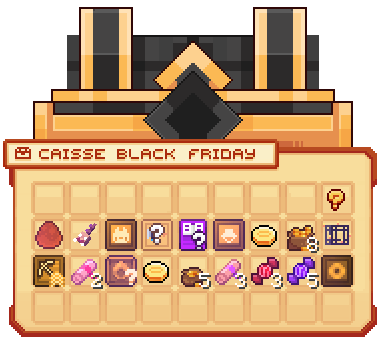

# 🛒 L'Événement Black Friday

L'événement **Black Friday** est accessible depuis le **PNJ présent au spawn** ou avec la commande **`/blackweek`**.

Le menu de l'événement permet de récupérer des récompenses quotidiennes, de progresser dans un pass individuel et dans des paliers communautaires, et d'accéder aux offres Black Friday.

## 🎁 Récompenses quotidiennes gratuites

Une **récompense gratuite** peut être récupérée chaque jour pendant l'événement.

<figure><figcaption>Accès aux récompenses quotidiennes depuis le menu Black Friday</figcaption></figure>

<figure><figcaption>Page des récompenses quotidiennes</figcaption></figure>

## 💳 Pass individuel

Le **pass individuel** progresse en fonction du montant dépensé en euros (€) sur la boutique. Chaque palier atteint permet de débloquer une nouvelle récompense.

<figure><figcaption>Accès au pass individuel depuis le menu Black Friday</figcaption></figure>

<figure><figcaption>Page du pass individuel</figcaption></figure>

## 🌍 Paliers communautaires

Chaque **Caisse Black Friday** ouverte par la communauté fait progresser un compteur commun. De nouvelles récompenses sont débloquées pour tous lorsque les différents paliers sont atteints.

<figure><figcaption>Accès aux paliers communautaires depuis le menu Black Friday</figcaption></figure>

<figure><figcaption>Page des paliers communautaires</figcaption></figure>

## 🛒 Pack Black Friday

Un **pack spécial Black Friday** est disponible depuis le **27 novembre à minuit** et jusqu'au **30 novembre**, au prix de **2 490 gemmes** 💎.

Il contient :

* **5 Clés Black Friday**
* **1 compagnon [Panthère Noire](../codex/les-compagnons/pets-legendaire.md)** (légendaire)
* **1 [Marteau Black Friday](../codex/outils/blackfriday.md)**
* **1 tag « Unique »**
* **2 Spawners aléatoires Black Friday**
* **1 Booster aléatoire Black Friday**
* **5 Bonbons à la fraise**
* **2 Parchemins Impossibles**
* **1 pack de fournitures automnales exclusif**
* **1 set de cosmétiques Catrina & Mariachi** (4 cosmétiques)

<figure><figcaption>Accès au pack depuis le menu Black Friday</figcaption></figure>

## 🎁 Caisse Black Friday

Cette partie du menu permet d'acheter des **Clés Black Friday** afin d'ouvrir la [**Caisse Black Friday**](les-caisses.md#caisse-black-friday).

Trois de ses récompenses changent chaque jour. L'offre **légendaire** contient toujours une **ancienne clé**, tandis que les lots des offres **épique** et **mythique** sont plus variés.

<figure><figcaption>Accès à la Caisse Black Friday depuis le menu</figcaption></figure>

<figure><figcaption>Page d'achat des Clés Black Friday</figcaption></figure>
