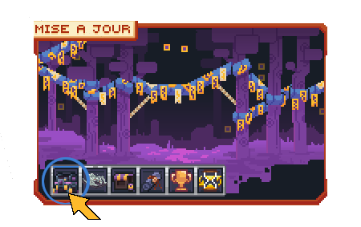
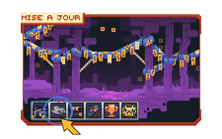
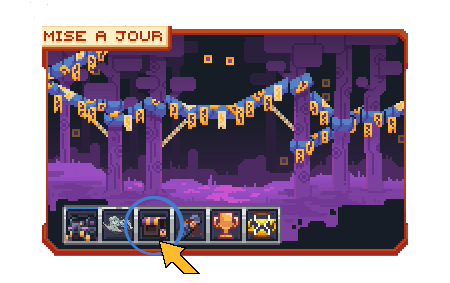
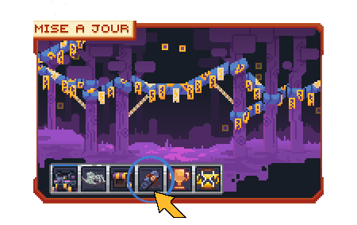
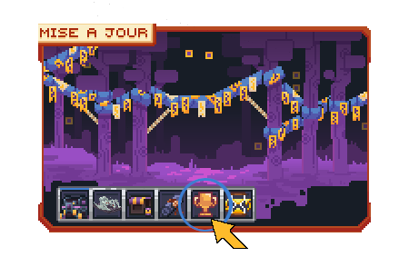
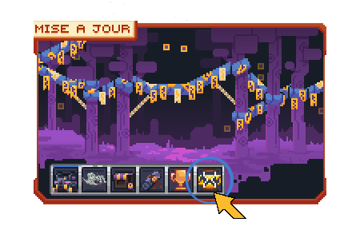
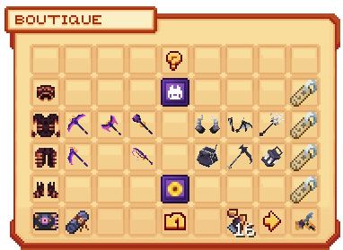
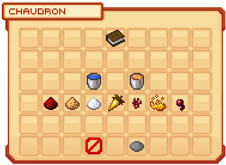
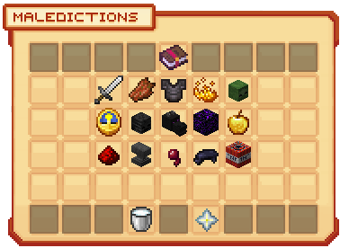

# 👁️ L'Événement Maudit

Le but de cet événement est de récupérer des **Écus Maudits** afin de les dépenser dans la **Boutique Maudite**.

## 🎃 Le menu de la mise à jour

La commande **`/halloween`** ouvre le menu principal de la mise à jour. Il permet d'accéder à la **Caisse Maudite**, aux nouvelles œuvres du musée, à la boutique, aux récompenses du **Parchemin Maudit**, au classement de l'événement et au **Donjon Maudit**.

<table border="1" cellspacing="0" cellpadding="6">
  <tr>
    <td><strong>Caisse Maudite</strong></td>
    <td><strong>Nouvelles œuvres du musée</strong></td>
  </tr>
  <tr>
    <td><figure><figcaption></figcaption></figure></td>
    <td><figure><figcaption></figcaption></figure></td>
  </tr>
  <tr>
    <td><strong>Boutique Maudite</strong></td>
    <td><strong>Récompenses du Parchemin Maudit</strong></td>
  </tr>
  <tr>
    <td><figure><figcaption></figcaption></figure></td>
    <td><figure><figcaption></figcaption></figure></td>
  </tr>
  <tr>
    <td><strong>Classement de l'événement</strong></td>
    <td><strong>Donjon Maudit</strong></td>
  </tr>
  <tr>
    <td><figure><figcaption></figcaption></figure></td>
    <td><figure><figcaption></figcaption></figure></td>
  </tr>
</table>

## ✨ Les nouveautés

### 👁️ Caisse Maudite

La nouvelle [**Caisse Maudite**](les-caisses.md#caisse-maudite) contient notamment l'**Armure Maudite**, des armes de classe et des outils maudits, des familiers ainsi que différentes récompenses liées à l'événement.

### 🦴 Nouvelles œuvres archéologiques

Trois nouvelles œuvres rejoignent le musée : la **Faucheuse**, le **Médecin de la Peste** et **Wyvern**. Toutes leurs pièces peuvent être obtenues grâce aux [**fouilles archéologiques**](archeologie.md) et dans le **Donjon Maudit**.

### 📜 Parchemin Maudit

Le **Parchemin Maudit** fait également son apparition. La liste de ses nouvelles récompenses est consultable directement depuis le menu **`/halloween`**.

## 🛍️ La Boutique Maudite

<figure><figcaption><strong>Boutique Maudite</strong></figcaption></figure>

La boutique propose notamment :

* l'[**Armure du Fossoyeur**](../codex/armure.md#armure-du-fossoyeur) ;
* les [**outils du Fossoyeur**](../codex/outils/fossoyeur.md) ;
* des **cosmétiques** ;
* de nouveaux **tags** et de nouvelles **peluches** ;
* un **pack de décoration** ;
* des **Tickets de Donjon Maudit** ;
* des **Parchemins Maudits** ;
* des **Fragments de Clé Maudite**.

## 🪙 Obtenir des Écus Maudits

Il existe trois moyens d'obtenir des **Écus Maudits**.

### ⛏️ Fouilles archéologiques

Chaque [**fouille archéologique**](archeologie.md) rapporte **15 Écus Maudits**. Cette méthode est peu recommandée en raison de son faible rendement.

### 🧪 Chaudron magique

<figure><figcaption><strong>Menu du Chaudron magique</strong></figcaption></figure>

Le **Chaudron magique** permet de créer des potions en choisissant :

1. une base : **eau** ou **lave** ;
2. entre **un et trois ingrédients**.

Tous les éléments sélectionnés doivent être présents dans votre inventaire. Une fois consommée, la potion vous rapporte des **Écus Maudits**. D'après les tests effectués, une potion peut rapporter jusqu'à **1 950 Écus Maudits**.

### ☠️ Donjon Maudit

Le **Donjon Maudit**, inspiré du Donjon Avatar, accueille de **un à quatre joueurs**. Le but est de résister le plus longtemps possible aux vagues de monstres. Pour passer à l'étape suivante, vous devez éliminer le nombre de monstres demandé.

Les mini-boss et les boss permettent d'obtenir des **coffres**. Leur ouverture rapporte notamment des **Écus Maudits**.

#### Récompenses du donjon

_Image à venir_

#### Malédictions


Les **malédictions** peuvent être activées **uniquement lorsque vous entrez seul** dans le Donjon Maudit. Elles ne sont pas disponibles lorsque vous jouez en groupe.


Lorsque vous entrez seul dans le donjon, vous pouvez choisir des **malédictions**. Elles augmentent la difficulté du donjon, mais améliorent également la rareté des récompenses.

<figure><figcaption><strong>Sélection des malédictions</strong></figcaption></figure>

Votre sélection détermine un **score de malédiction** et permet d'atteindre trois paliers :

| Score | Bonus de rareté des coffres |
| :---: | :---: |
| **100 points** | **+1 rang** |
| **300 points** | **+2 rangs** |
| **500 points** | **+3 rangs** |
